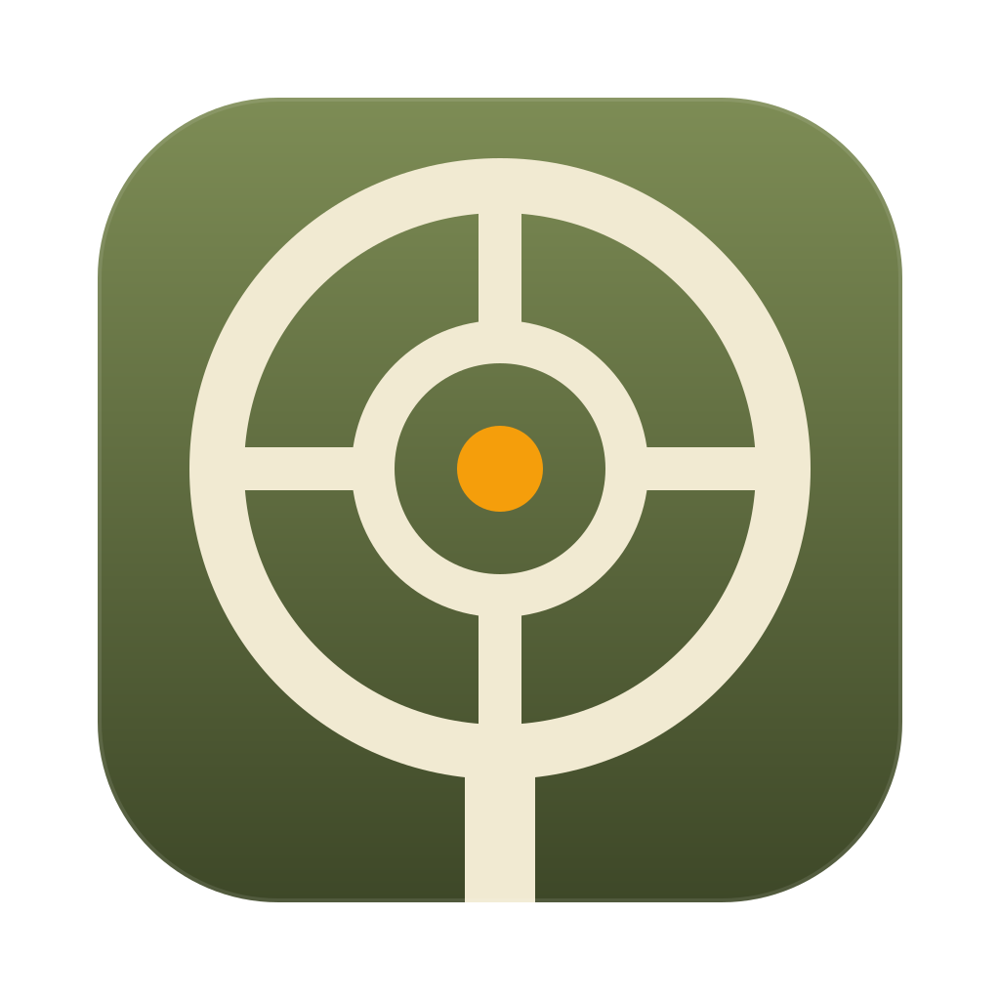

# Gunner

A native macOS menu bar app for running long-running terminal processes (dev servers, watchers, tunnels) in the background.

- **Click** the menu bar icon to see every process, its status, and its live logs.
- **Right-click** it to start or stop processes straight from the menu.
- The menu bar shows how many processes are running, plus a ⚠︎ count for crashed ones.

Swift 6, SwiftUI, and AppKit. No dependencies. Requires macOS 15+.

## Usage

```sh
make install   # build Gunner.app and copy it to /Applications
make run       # build build/Gunner.app and open it
make test      # swift test
```

Turn on **Launch at Login** from the right-click menu. It only works when Gunner runs from the app bundle.

To review the UI without clicking through it, render every screen to PNGs:

```sh
GUNNER_SNAPSHOT_DIR=/tmp/shots swift test --filter Snapshot
```

## How it works

Commands run with `$SHELL -c`, using the environment captured once from an interactive login shell, so `PATH`, nvm, and so on behave as they do in Terminal. Each command is started with `posix_spawn` in its own process group. Stopping a process sends `SIGTERM` to the whole group and follows up with `SIGKILL` after 5 seconds. Quitting Gunner stops everything it started.

With **Restart automatically** on, a process that exits is restarted with exponential backoff (1s, 2s, 4s … up to 30s). The backoff resets once the process stays up for 30 seconds.

Process definitions are saved to `~/Library/Application Support/Gunner/processes.json`.

| Path | |
| --- | --- |
| `Sources/Gunner/Core/ChildProcess.swift` | `posix_spawn` in a new process group; reading output; waiting for exit. |
| `Sources/Gunner/Core/ManagedProcess.swift` | One process's state, plus the supervisor task that runs and restarts it. Cancelling the task stops it. |
| `Sources/Gunner/Core/ProcessManager.swift` | The list of processes and persistence. |
| `Sources/Gunner/Core/ShellEnvironment.swift` | Captures the login shell environment. |
| `Sources/Gunner/App.swift` | Status item, popover, right-click menu, quit handling. |
| `Sources/Gunner/UI/` | SwiftUI screens. The log view is an `NSTextView` with ANSI colors and ⌘F find. |
| `scripts/bundle.sh` | Assembles and ad-hoc signs `build/Gunner.app`. |
